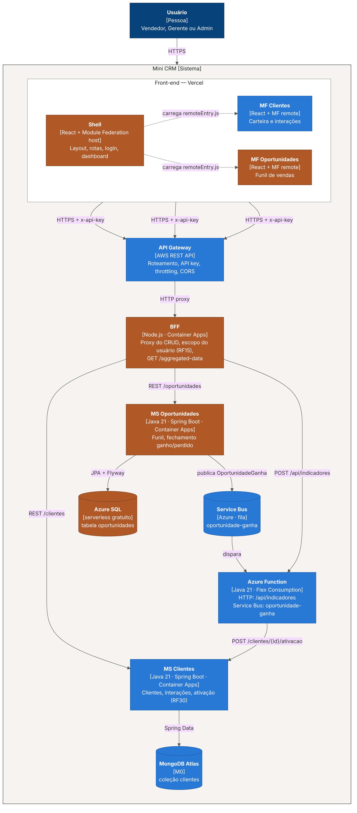
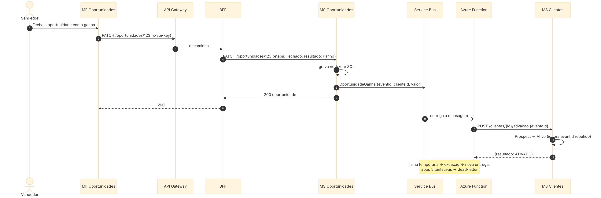

# Mini CRM — Arquitetura distribuída (PJBL)

Evolução do [Mini CRM](https://github.com/PedroZCosta/Mini-CRM) para uma arquitetura distribuída com **microfrontends, API Gateway, BFF, microsserviços, eventos e serverless**, aplicando **Clean Architecture** e **Vertical Slice**.

Este é o **repositório central** do sistema: frontends (Shell e microfrontends), documentação de arquitetura (C4, Canvas, ARC42), infraestrutura (AWS API Gateway e scripts da Azure) e os links da entrega. Cada serviço de backend tem o seu próprio repositório, CI e imagem Docker.

## Repositórios do sistema

| Repositório | Componente | Tecnologia | Dono | Situação |
| --- | --- | --- | --- | --- |
| [minicrm-ms-clientes](https://github.com/Le3Dev/minicrm-ms-clientes) | MS Clientes (MongoDB Atlas) | Java 21, Spring Boot 3.5 | A | pronto, 33 testes |
| [minicrm-function](https://github.com/Le3Dev/minicrm-function) | Azure Function: `/api/indicadores` (HTTP) + `oportunidade-ganha` (Service Bus) | Java 21 | A | pronto, 29 testes |
| [minicrm-ms-oportunidades](https://github.com/Le3Dev/minicrm-ms-oportunidades) | MS Oportunidades / funil (Azure SQL) | Java 21, Spring Boot 3.5 | B | esqueleto com 2 slices + TODO |
| [minicrm-bff](https://github.com/Le3Dev/minicrm-bff) | BFF (`GET /aggregated-data` + proxy) | Node.js (NestJS) | B | a fazer |
| **minicrm-arquitetura** (este) | Frontends, docs e infra | — | os dois | ver abaixo |

## O que fica neste repositório

| Pasta | Conteúdo | Dono | Situação |
| --- | --- | --- | --- |
| [`mf-clientes`](mf-clientes) | Microfrontend de Clientes (remote) | A | pronto, 9 testes |
| `mf-oportunidades` | Microfrontend do funil (remote) | B | a fazer |
| `shell` | Shell (host): menu, seletor de usuário, dashboard | B | a fazer |
| [`docs`](docs) | C4 (contexto, containers, componentes), sequência do evento, Canvas, ARC42 | os dois | C4 e Canvas prontos |
| [`infra/aws`](infra/aws) | AWS API Gateway (API key, throttling, CORS) | A | script pronto |
| [`infra/azure`](infra/azure) | Service Bus, Container Apps, Function App | A | script pronto |

Cada frontend é publicado separadamente na Vercel (mesmo repositório, Root Directory diferente: `shell`, `mf-clientes`, `mf-oportunidades`).

## Fluxo

1. O usuário abre o **Shell** (Vercel), que carrega os microfrontends.
2. Toda chamada vai ao **AWS API Gateway** com `x-api-key`, que encaminha ao **BFF**.
3. O BFF faz o proxy do CRUD para o **MS Clientes** (MongoDB) e o **MS Oportunidades** (Azure SQL).
4. `GET /aggregated-data`: o BFF busca clientes e oportunidades e manda à **Azure Function** (`/api/indicadores`), devolvendo tudo num único JSON.
5. Ao fechar uma oportunidade como **ganha**, o MS Oportunidades publica `OportunidadeGanha` no **Service Bus**; a Function consome e chama o MS Clientes, que passa o cliente para **Ativo** (RF30), de forma idempotente.

## Contratos entre as partes

| De → Para | Contrato |
| --- | --- |
| Front → Gateway → BFF | Rotas `/clientes/*`, `/oportunidades/*`, `/aggregated-data`, sempre com `?usuarioId=` |
| BFF → MS Clientes | Swagger em `/docs` (`responsavelId` aceita lista para o escopo do RF15) |
| BFF → Function | `POST /api/indicadores` `{ clientes, oportunidades }` + header `x-functions-key` — [openapi.yaml](https://github.com/Le3Dev/minicrm-function/blob/main/src/main/resources/docs/openapi.yaml) |
| MS Oportunidades → Function | Evento `OportunidadeGanha` na fila `oportunidade-ganha` — [asyncapi.yaml](https://github.com/Le3Dev/minicrm-function/blob/main/src/main/resources/docs/asyncapi.yaml) |
| Function → MS Clientes | `POST /clientes/{id}/ativacao` `{ eventoId, oportunidadeId }` |

## Integração contínua

- **Serviços** (MS Clientes, MS Oportunidades, BFF): workflow `ci.yml` na raiz de cada repositório. Testes em todo push; numa tag `v*` (ex.: `v1.0.0`), a imagem vai para o Docker Hub (secrets `DOCKERHUB_USERNAME` e `DOCKERHUB_TOKEN` em cada repositório). Os serviços Java publicam o resumo dos testes como um check no commit (aba **Checks**).
- **Function**: testes em todo push; deploy automático opcional (secret `AZURE_CREDENTIALS`).
- **Frontends** (este repositório): um workflow por pasta em `.github/workflows`, disparado só quando ela muda.

Imagens: `leandrocanha/minicrm-ms-clientes`, `leandrocanha/minicrm-ms-oportunidades`, `leandrocanha/minicrm-bff`. O Docker Hub só aceita `usuario/repositorio`, por isso o nome usa hífen em vez de `usuario/minicrm/servico`.

## Links da entrega (preencher após o deploy)

| Item | URL |
| --- | --- |
| GitHub — repositório central | https://github.com/Le3Dev/minicrm-arquitetura |
| GitHub — MS Clientes | https://github.com/Le3Dev/minicrm-ms-clientes |
| GitHub — Function | https://github.com/Le3Dev/minicrm-function |
| GitHub — MS Oportunidades | https://github.com/Le3Dev/minicrm-ms-oportunidades |
| GitHub — BFF | https://github.com/Le3Dev/minicrm-bff |
| Front (Shell) | |
| MF Clientes | |
| MF Oportunidades | |
| API Gateway | |
| Swagger BFF | |
| Swagger MS Clientes | |
| Swagger MS Oportunidades | |
| Swagger / Eventos da Function | |
| Docker Hub | https://hub.docker.com/u/leandrocanha |
| Vídeo (YouTube, não listado) | |

## Alunos

Pedro Henrique Z. Costa · Lincoln Neto · Nicolas Tancon · Leandro Canha
